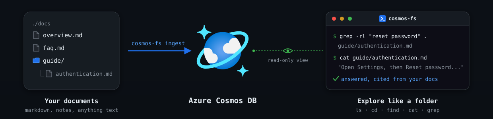
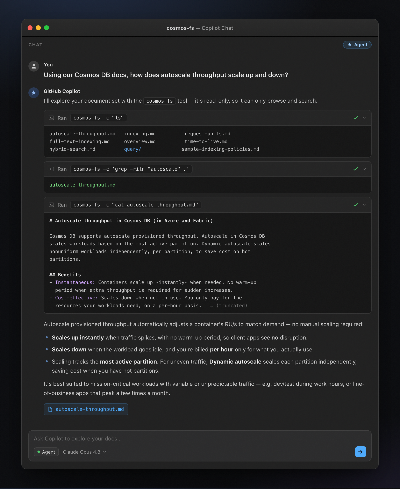

<p align="center">
  <picture>
    <source media="(prefers-color-scheme: dark)" srcset="assets/cosmos-fs-logo-dark.svg">
    
  </picture>
</p>

A simple CLI tool to browse document content stored in Azure Cosmos DB. Explore your data
(docs, notes, anything you ingest) with usual shell commands you know and love: `ls`, `cd`, `find`,
`cat`, and `grep`.

<p align="center">
  
</p>

## Where this fits

When you need semantic search over your documents, vector or hybrid search is the right tool. `cosmos-fs` presents a Cosmos DB container as a read-only folder of files that can be explored using shell commands. Its really simple to use, for humans and AI Agents! In fact, `cosmos-fs` is built with agents in mind. Think about it, an agent already knows shell commands. So you point it at
`cosmos-fs` and ask a question in plain language. It turns that into the appropriate commands - for example,
`find` or `grep` to locate the pages that mention the topic, then `cat` to read the best match
and answer from it.

You don't need an SDK, MCP server, or API to use `cosmos-fs`. However, it ships with an [agent skill](skills/cosmos-fs/SKILL.md) to make it easier for agents to use.

Say you've ingested your product docs into Cosmos DB. Ask "how do I reset my password?" and the
agent greps for `password`, reads the page that matches, and answers with a citation. Because
`cosmos-fs` only ever reads, you can let it run on its own without risking your data.

> Under the hood, the shell comes from [just-bash](https://www.npmjs.com/package/just-bash), an in-memory bash written in TypeScript, and `cosmos-fs` supplies the filesystem behind it.

<p align="center">
  
  <br />
  <em>Ask in plain language; the agent runs read-only <code>cosmos-fs</code> commands and answers from your docs.</em>
</p>

## Get started

You need Node >= 20, pnpm, and an Azure sign-in with data-plane access to your Cosmos DB account
(`az login`; AAD only, no keys). Point `cosmos-fs` at the database and container that hold your
documents (you set them; there are no defaults) and start exploring:

```bash
pnpm install && pnpm build && npm link       # build, then put `cosmos-fs` on your PATH
az login                                      # AAD auth; no account keys
export COSMOS_ENDPOINT="https://<account>.documents.azure.com:443/"
export COSMOS_DATABASE=<database> COSMOS_CONTAINER=<container>
cosmos-fs -c "ls"                             # list the document set
```

A few things to try next:

```bash
cosmos-fs -c "grep -rwl throughput ."         # whole-word search (uses the full-text index)
cosmos-fs -c "cat overview.md | head -20"     # read an item and pipe it
cosmos-fs                                      # interactive shell (cwd persists)
```

No documents yet? [Index your own docs](docs/quickstarts/01-index-your-docs.md) provisions a
container and loads bundled sample docs to explore. For the full setup (data-plane role,
`.env`, container overrides, flags), see [Setup](docs/quickstarts/setup.md). The full command
reference is `cosmos-fs --help` or [docs/cli.md](docs/cli.md).

## Quickstarts

Step-by-step guides that take you from an empty account to exploring your documents:

- [Setup and prerequisites](docs/quickstarts/setup.md): Azure sign-in, data-plane role, install.
- [Index your own docs](docs/quickstarts/01-index-your-docs.md): load a local folder and explore it.
- [Explore an existing container](docs/quickstarts/02-map-existing.md): map cosmos-fs onto data you already have.
- [Use cosmos-fs as an AI agent tool](docs/quickstarts/03-agent-tool.md): wire it into an agent loop.

## Bring your own data

`cosmos-fs` reads what is already in your container, which gives you two ways in. **Write** a
local folder into the shape it expects with `cosmos-fs ingest`, or **map** the reader onto an
*existing* container's fields with no re-ingest, so it can read data another tool wrote (a
LangChain store, for example). The [concepts](docs/concepts.md) explain the model.
[ingest.md](docs/ingest.md) and the quickstarts for [writing](docs/quickstarts/01-index-your-docs.md)
and [mapping](docs/quickstarts/02-map-existing.md) have the details.

## Docs

- [docs/concepts.md](docs/concepts.md): the model (roles, how it works). Start here.
- [docs/cli.md](docs/cli.md): using the CLI (or run `cosmos-fs --help`).
- [docs/recipes.md](docs/recipes.md): worked examples (navigate, search, read).
- [docs/ingest.md](docs/ingest.md): provision and load your own data.
- [docs/guides/namespaces.md](docs/guides/namespaces.md): separate document sets with namespaces.
- [docs/guides/pdfs.md](docs/guides/pdfs.md): convert and ingest PDF content.